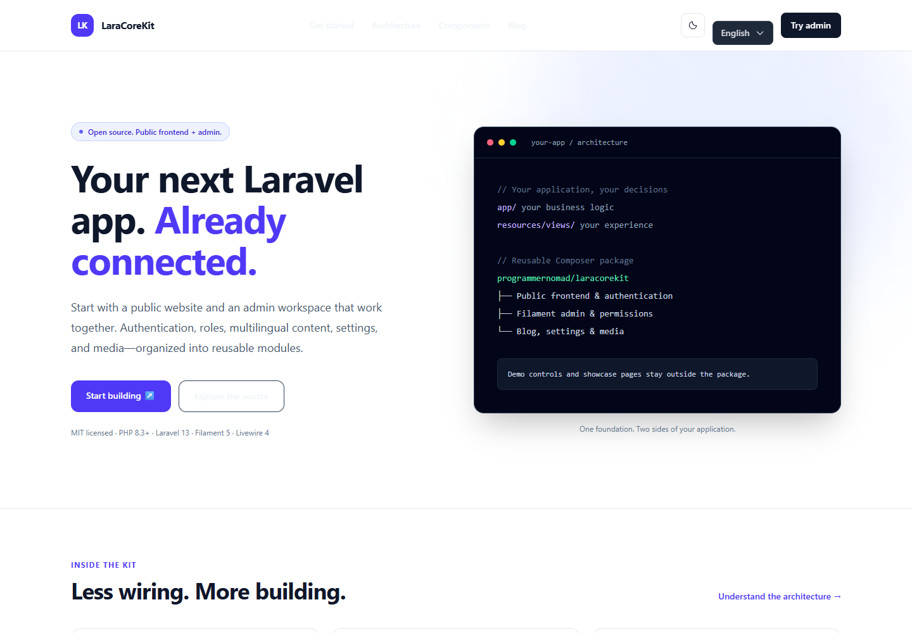
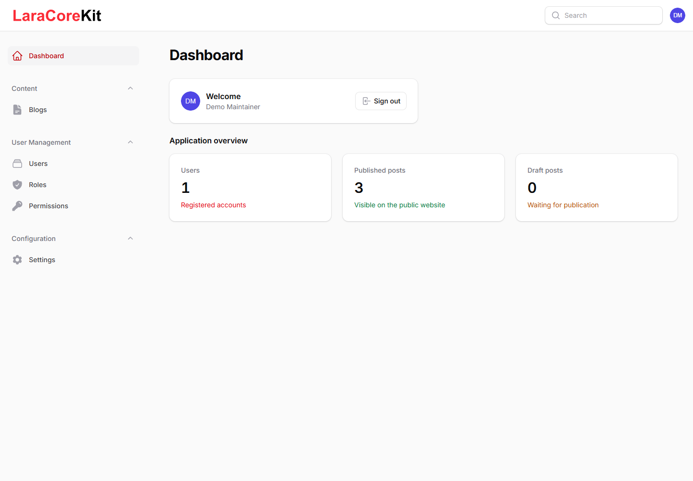
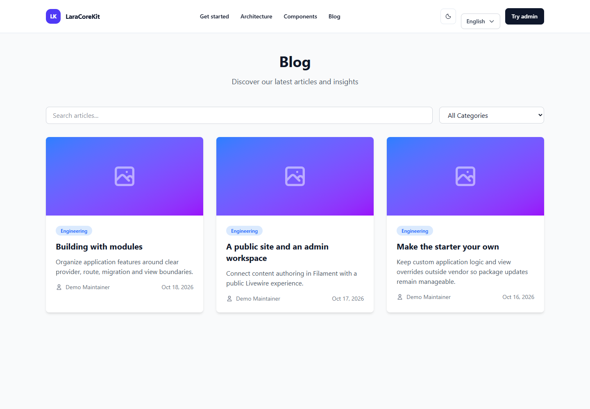
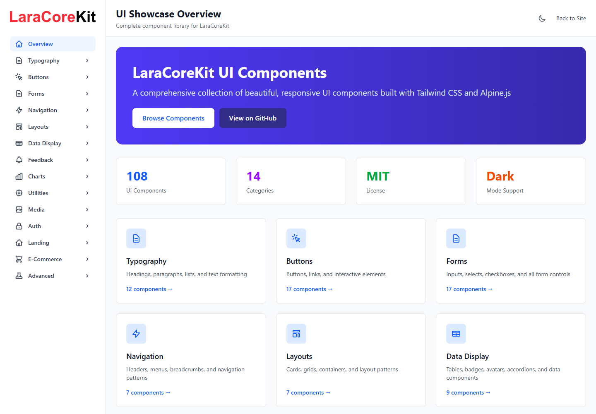

# LaraCoreKit

**A modular Laravel foundation for your public website and admin workspace.**

Laravel 13 · Filament 5 · Livewire 4 · Tailwind CSS 4 · PHP 8.3+ · MIT

[Demo website](https://www.laracorekit.com) · [Documentation](https://www.laracorekit.com/docs) · [Installation](docs/installation.md) · [Security policy](SECURITY.md)



## Package and demo are separate

The reusable Composer package is **`programmernomad/laracorekit`**, maintained under [`packages/core`](packages/core). It includes public authentication and blog pages, a Filament admin panel, users, roles/permissions, settings and media. It is not admin-only.

This repository also hosts the marketing website, documentation viewer, component showcase and the separately published [demo module](https://packagist.org/packages/programmernomad/laracorekit-demo-module). Those features and sample accounts stay outside the reusable package.

**Release status:** stable releases are on [Packagist](https://packagist.org/packages/programmernomad/laracorekit) (`^0.1`). Install into a fresh Laravel 13 application:

```bash
composer require programmernomad/laracorekit:"^0.1"
php artisan laracorekit:install
```

See the [installation guide](docs/installation.md) for database setup, GitHub `dev-main` installs and compatibility notes for existing user models and route names.

## Run the complete GitHub host

Requires Composer 2, PHP 8.3+ and Node 22.12+ (CI uses Node 24).

```bash
git clone https://github.com/ProgrammerNomad/LaraCoreKit.git my-app
cd my-app
composer install
npm ci
```

Copy `.env.example` to `.env`, configure your database, then:

```bash
php artisan key:generate
php artisan migrate --seed
php artisan laracorekit:admin
php artisan storage:link
npm run build:core
npm run build
php artisan serve
```

Normal seeding creates roles, not public sample accounts. Only a disposable demo instance should enable `DEMO_MODE=true` and run the guarded DemoSeeder. Never use demo credentials in production.

## What is included

| Public frontend | Admin and infrastructure |
| --- | --- |
| Login and password recovery | Filament administration |
| Optional registration and account dashboard | Users, roles and permissions |
| Public multilingual blog | Blog authoring and publication |
| English, Hindi and Arabic language switching | Settings and media attachments |
| RTL-aware shared layout | Configurable modules and view overrides |

API tokens, enforced email verification, billing, tenancy and a marketplace are not bundled. Check [architecture](docs/core/architecture.md) and [production setup](docs/deployment/production.md) before adopting.

## Screenshots





Screenshots show the local demonstration application, including host-only features. They do not imply that the demo website is included in the package.

## Development and validation

```bash
composer test
composer pint-test
composer phpstan
composer audit --locked
npm audit
npm run build:core
npm run build
```

See [contribution guidelines](CONTRIBUTING.md), [upgrade guide](docs/upgrade-guide.md), and [package release checklist](docs/package-release.md). Keep changes to package code in `packages/core`; site-specific changes belong in the host. Published assets must be rebuilt when their source changes.

## Adoption and privacy

No registration, activation or telemetry is required. Packagist downloads can measure distribution activity after publication, not unique developers or active projects. The host includes a validated daily snapshot command and optional scheduler configuration; see [release and metrics setup](docs/package-release.md). Contributions, issues and voluntary showcase submissions are welcome. Search engines and AI tools can read server-rendered docs and `/llms.txt`; no ranking or recommendation is promised.

## License

[MIT](LICENSE). Report sensitive vulnerabilities through the [security policy](SECURITY.md).
